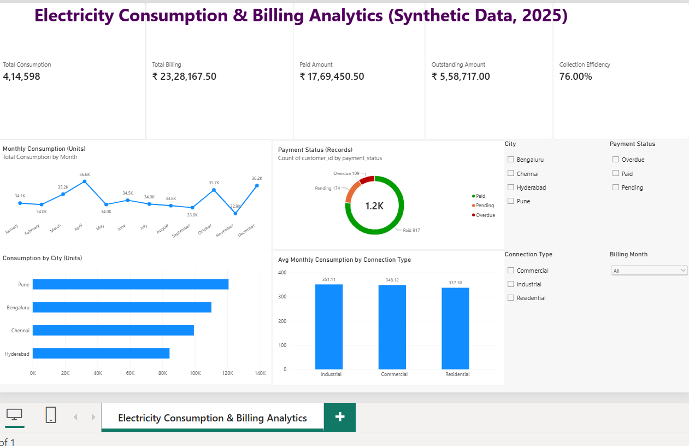

# Electricity Consumption & Billing Analytics

An end-to-end analytics project using Python, SQL (SQLite) and Power BI.

> **Note:** This is a personal learning project. All data is **synthetic** (randomly generated for 100 fictional customers). It is not real company or customer data, so the patterns in the results are not real business findings. The goal is to show the analytics workflow: generate, validate, query, model, measure and visualize.

## Dashboard



## Business questions

- How much electricity is consumed in total, and how does it vary by city, month and connection type?
- How much money is billed, how much is collected, and how much is outstanding?
- What share of billed money is paid, pending or overdue?
- Which customers and cities contribute the most to consumption?

## Tech stack

- **Python:** Pandas, NumPy, Matplotlib (data generation, validation, exploratory analysis)
- **SQL:** SQLite (joins, CTEs, CASE WHEN, window functions)
- **Power BI:** data modelling, DAX measures, interactive dashboard

## Project structure

```
Electricity_Consumption_Analytics/
├── README.md
├── requirements.txt
├── .gitignore
├── data/             customers.csv, consumption_records.csv
├── scripts/          main.py, load_database.py, run_sql.py, eda.py
├── sql/              analysis_queries.sql
├── powerbi/          Electricity_Consumption_Dashboard.pbix
└── images/           charts and dashboard screenshot
```

## How to run

Run all commands from the project root folder.

```
pip install -r requirements.txt
python scripts/main.py
python scripts/load_database.py
python scripts/run_sql.py
python scripts/eda.py
```

1. `main.py` generates the two CSV files in `data/` and runs data quality checks.
2. `load_database.py` loads the CSVs into a SQLite database (`electricity_analytics.db`).
3. `run_sql.py` runs the analysis queries (also saved in `sql/analysis_queries.sql`).
4. `eda.py` performs exploratory analysis and saves three charts to `images/`. Close each chart window to continue.

To view the dashboard, open `powerbi/Electricity_Consumption_Dashboard.pbix` in Power BI Desktop.

## Dataset (synthetic)

**customers** (100 rows)

| Column | Description |
|---|---|
| customer_id | Unique ID (1001 to 1100) |
| customer_name | Fictional name |
| city | Hyderabad, Bengaluru, Chennai or Pune |
| connection_type | Residential, Commercial or Industrial |

**consumption_records** (1,200 rows, 12 months x 100 customers; the table is called `consumption` in SQLite)

| Column | Description |
|---|---|
| customer_id | Links to customers |
| billing_month | Month in YYYY-MM format (2025-01 to 2025-12) |
| units_consumed | Units used (80 to 600) |
| rate_per_unit | Rate in rupees (4.5, 5.0, 5.5, 6.0 or 7.0) |
| total_bill | units_consumed x rate_per_unit |
| payment_status | Paid, Pending or Overdue |

## Data quality checks

- Missing values: 0 in every column
- Duplicate records: 0

## Key results

| Metric | Value |
|---|---|
| Total consumption | 414,598 units |
| Total billing | ₹23,28,167.50 |
| Paid amount | ₹17,69,450.50 |
| Outstanding amount (Pending + Overdue) | ₹5,58,717 |
| Collection efficiency | 76.0% |
| Bills: Paid / Pending / Overdue | 917 / 174 / 109 |
| Highest consumption city | Pune (120,739 units, 29.12%) |
| Highest / lowest month | April (36,636) / November (32,945) |

Average monthly consumption by connection type: Industrial 351.11, Commercial 348.12, Residential 337.30.

These figures match across the Python, SQL and Power BI outputs.

## SQL techniques used

Joins, GROUP BY, CASE WHEN, CTEs, and window functions (`RANK()`, `SUM() OVER`). All queries are in `sql/analysis_queries.sql`, each with a comment stating the question it answers.

## Power BI

**Model:** one-to-many relationship from `customers[customer_id]` to `consumption_records[customer_id]` (single cross-filter direction).

**DAX measures**

```
Total Consumption = SUM(consumption_records[units_consumed])

Total Billing = SUM(consumption_records[total_bill])

Paid Amount =
CALCULATE(
    SUM(consumption_records[total_bill]),
    consumption_records[payment_status] = "Paid"
)

Outstanding Amount =
CALCULATE(
    SUM(consumption_records[total_bill]),
    consumption_records[payment_status] IN {"Pending", "Overdue"}
)

Collection Efficiency =
DIVIDE([Paid Amount], [Total Billing], 0)
```

**Dashboard:** 5 KPI cards, a monthly consumption line chart, a city-wise bar chart, a payment status donut chart, a connection type column chart, and slicers for city, connection type, payment status and billing month.

## Limitations

- The data is randomly generated, so consumption is spread fairly evenly across months, cities and connection types. Differences between categories are small and should not be read as real insights.
- Only one year (2025) of data is included.

## Possible extensions

- Customer segmentation by consumption and payment behaviour
- Overdue payment analysis by city and connection type
- Trend analysis on a longer, more realistic dataset

## Author

Harsha Vardhan Sreeram